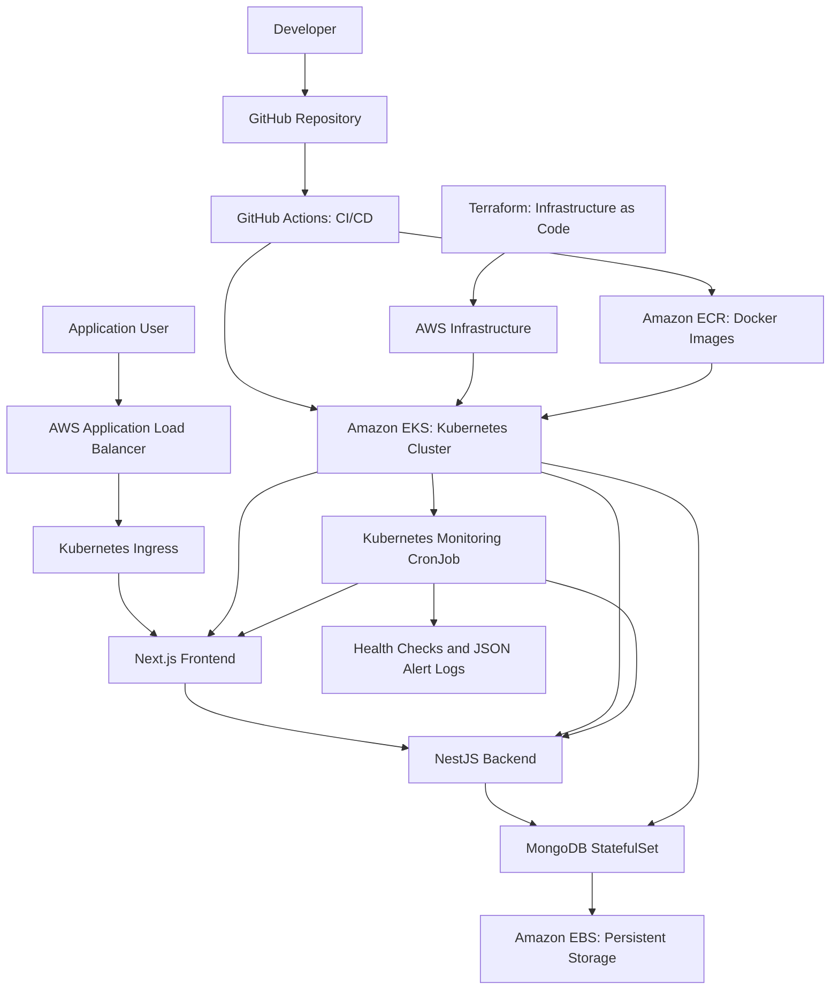

# TaskHub System Architecture

## Architecture Explanation

TaskHub is a multi-service application deployed on Amazon EKS using Kubernetes. Terraform provisions the AWS infrastructure, including the networking and Kubernetes cluster. The application consists of a Next.js frontend, a NestJS backend, and a MongoDB database.

Users access TaskHub through an AWS Application Load Balancer, which forwards requests through Kubernetes Ingress to the frontend. The frontend communicates with the backend through the Kubernetes internal network, while the backend stores and retrieves application data in MongoDB. Amazon EBS provides persistent storage so database information survives pod restarts.

GitHub Actions automates the CI/CD process. It checks application code, builds Docker images, pushes them to Amazon ECR, and deploys updated images to EKS when changes are merged into the main branch.

A Kubernetes CronJob runs every five minutes to check frontend and backend health. Bash performs the checks, while Python generates structured alerts in the container logs when a check fails. Kubernetes Metrics Server also provides CPU and memory usage information.
